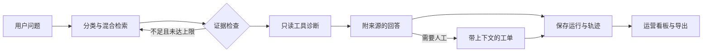

# ResolveAI · 企业 IT HelpDesk Agent

基于 [AI SupportPro](https://github.com/theclevertrader/ai-supportpro) 的 IT 支持场景改造，保留原始 MIT 许可证和版权。来源提交与改动范围见 [NOTICE.md](NOTICE.md) 和 [UPSTREAM.json](UPSTREAM.json)，原项目说明见 [README.upstream.md](README.upstream.md)。这是可运行的本地开发 MVP，覆盖证据诊断、人工交接与运营观测。

[](https://github.com/Marvin725626/resolveai-it-helpdesk/actions/workflows/ci.yml)

**FastAPI · LangGraph · React · 混合 RAG · IT HelpDesk**

[v1.1.0 版本说明](https://github.com/Marvin725626/resolveai-it-helpdesk/releases/tag/v1.1.0) · [工单处理流程](docs/TICKET_WORKFLOW.md) · [三分钟演示](docs/DEMO.md) · [截图与功能说明](docs/SHOWCASE.md) · [架构](docs/ARCHITECTURE.resolveai.md) · [验证记录](docs/VALIDATION.md) · [更新记录](CHANGELOG.md)

### 运营看板实机截图


截图来自本地离线演示的实际运行。指标是演示账号的诊断记录，不代表生产业务效果或真实模型响应耗时。

### 工作流程



## 已实现

- 中文 React 工作台：问题诊断、引用原文、实时节点轨迹、工具返回值、人工工单、知识入库和运行记录。
- FastAPI + LangGraph：分类 → 混合检索 → 证据检查 → 工具调用 → 回答 / 人工工单。证据不足最多检索两次。
- 检索：SQLite 下 BM25 + 本地 hash 向量；PostgreSQL 下全文检索 + 真正的 pgvector 向量查询；RRF 融合与词项覆盖重排。
- 工具：当前用户账号状态、服务健康、当前用户历史工单。前两项明确为本地模拟数据；工具身份由 JWT 固定，不接收任意员工身份。
- 工单附带问题、SOP 证据、工具输出和诊断；支持接手、解决、关闭与重新处理。
- 请求 ID 防重复工单、租户 / 用户隔离、凭据文本脱敏、图执行上限和模型超时。
- 工作台时间按 Asia/Hong_Kong 显示；API 输出明确的 UTC 时间戳。
- 运营看板：最近 7 / 30 / 90 天诊断趋势、转人工率、证据通过率、平均 / P95 耗时、问题分类与工单状态分布；支持指标 JSON 导出。
- 工单接手到当前工程师、内部处理备注、自动保存的状态时间线，以及等待反馈 / 继续处理 / 解决 / 关闭 / 重新处理。
- 按优先级计算的演示解决时限：即将超时、超时与按时完成提醒；自然小时计时，不暂停、不重置。
- 工单搜索、状态 / 优先级 / 时限筛选与 CSV 导出；CSV 包含接手人和目标截止时间，处理中文、引号与公式前缀。
- 诊断“有帮助 / 仍需帮助”反馈持久化，允许修改选择，看板统计实际反馈数量。
- 当前接手人权限、状态机、带时间版本的更新冲突检测、备注请求防重复、备注脱敏；旧版接口不能绕过 ResolveAI 工单处理流程。
- 22 项后端隔离回归测试、CSV 格式验证、可复用浏览器演示脚本，以及 6 个标注场景的本地评估脚本。

### 实际工单处理记录


操作者与时间由后端记录。备注描述的是本地演示操作，未连接真实企业系统；升级前的工单不会补造历史记录。

## 本机启动

项目路径：`E:\agent\resolveai`。已安装独立 `.venv` 和前端依赖，不需要启动第一个项目。

```powershell
cd E:\agent\resolveai
.\start.ps1
```

也可双击 `start_dev.bat`。脚本以隐藏后台进程运行服务，日志保存在 `.local/logs/`。

- 工作台：http://127.0.0.1:5174
- API 文档：http://127.0.0.1:8104/docs
- 演示邮箱：`demo@resolveai.example.com`
- 演示密码：`ResolveAI123!`

停止本项目进程：

```powershell
.\stop.ps1
```

如端口被占用，可运行 `.\start.ps1 -ApiPort 8105 -WebPort 5175`，前端代理会对应调整。

## 其他机器安装

需要 Python 3.11+、Node.js 22+。锁定依赖来自本机已验证的安装版本。

```powershell
python -m venv .venv
.\.venv\Scripts\python.exe -m pip install -r backend\requirements.lock.txt
cd frontend
npm ci
cd ..
Copy-Item backend\.env.example.resolveai backend\.env
# 将 AUTH_SECRET 改成随机值后启动。
.\start.ps1
```

启动时只在 development 且 `IT_DEMO_ENABLED=true` 时创建演示账号和五份 IT SOP。SQLite 文件为 `backend/resolveai.db`。账号、运行记录和工单均在独立数据库中。

## 接入真实模型

编辑 `backend/.env`：

```dotenv
DEFAULT_LLM_PROVIDER=openai
OPENAI_BASE_URL=https://your-provider.example/v1
OPENAI_API_KEY=your-key
OPENAI_MODEL=your-model
IT_EMBEDDING_PROVIDER=local
IT_EMBEDDING_DIMENSION=256
```

重启后端即可使用 OpenAI-compatible 模型进行函数调用选择与回答生成。模型必须支持 chat completions 的 tools；未配置密钥会让工具节点失败并转人工，不会伪装成成功。模型生成引用须来自检索到的来源，否则回退到 SOP 原文并转人工。真实模型不等于真实企业工具，账号和服务检查仍为模拟数据。

如使用真实 embedding，配置 `IT_EMBEDDING_PROVIDER=openai` 与 `OPENAI_EMBEDDING_MODEL`。更换维度需要新建开发数据库或编写迁移并重新索引；不要混用不同模型生成的向量。当前本机验证使用离线规则、SOP 摘录与本地 hash 向量，**没有进行真实 LLM 调用验证**。

## PostgreSQL / Docker

独立编排文件为 `compose.resolveai.yml`，使用 `pgvector/pgvector:pg16`。根目录 `.env` 需要配置随机 `AUTH_SECRET` 和 `POSTGRES_PASSWORD`。

```powershell
docker compose -f compose.resolveai.yml up --build -d
```

数据库初始化创建 vector 扩展、HNSW 向量索引与 GIN 全文索引。当前电脑的 Docker daemon 未运行，所以该路径已实现但尚未进行容器 / PostgreSQL 集成验证。它仍是本地演示配置，不能当作生产部署。

## 验证

```powershell
cd backend
..\.venv\Scripts\python.exe -m pytest tests/test_resolveai.py -q
cd ..\frontend
npm run test:csv
npm run build
cd ..
.\.venv\Scripts\python.exe scripts\evaluate.py
```

回归测试使用临时数据库，不修改演示数据库。评估会在演示库中生成运行记录及对应工单，结果写入 `docs/evaluation.local.json`。指标包括 Recall@4、MRR、升级决策正确率和延迟。六个小样本不能支持真实业务准确率；引用格式检查也不等于 Faithfulness 评估。具体限制见 [架构说明](docs/ARCHITECTURE.resolveai.md)。

## 展示与统计口径

看板诊断指标统计当前账号；工单状态统计当前工作区的全部工单。日期按香港时间划分，转人工率与证据通过率以完成诊断为分母，无样本时显示 `—`。证据通过率不是正确率；P95 使用最近秩法。

工单列表、搜索及 CSV 导出覆盖最近 100 张工作区工单，导出仅包含列表摘要。详细边界与演示步骤见 [DEMO.md](docs/DEMO.md)。GitHub 提供源码和截图；运行工作台需要启动本地服务。

## 示例

1. “VPN 连不上，提示认证超时，怎么排查？” → VPN SOP、模拟服务降级、自动人工工单。
2. “如何安装公司批准的办公软件？” → 软件 SOP 与来源引用。
3. “账号权限申请，请帮我转人工审批” → 带证据的人工工单。
4. “如何购买潜水艇发动机？” → 最多两次检索、证据不足转人工。

请依据实际代码、实测结果及本人完成的工作描述项目。当前代码不执行账号解锁、权限授予、生产服务重启，也没有真实企业部署数据。
