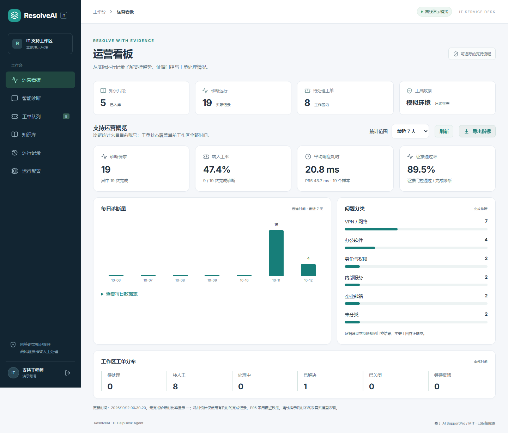
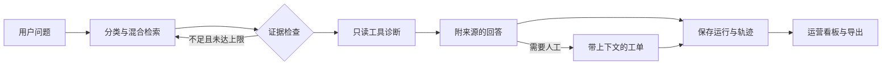
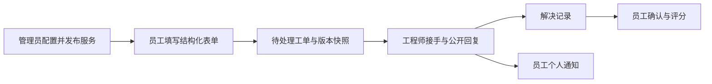
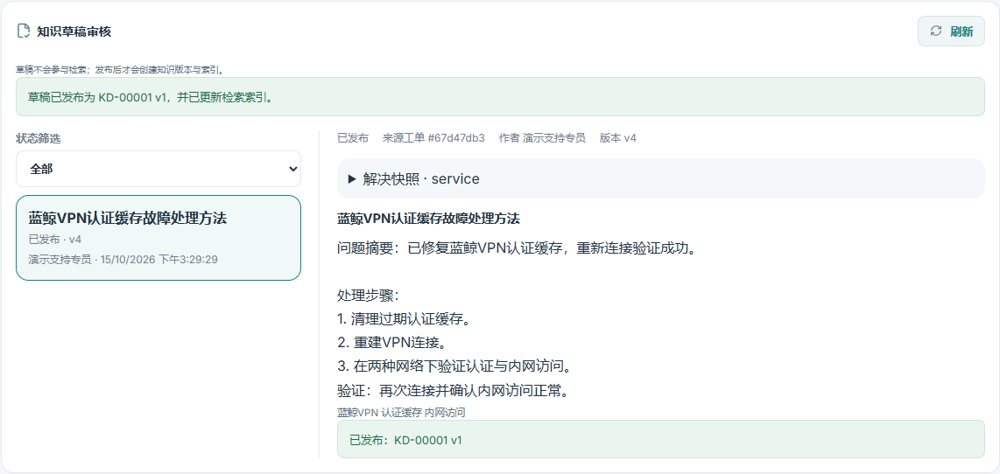
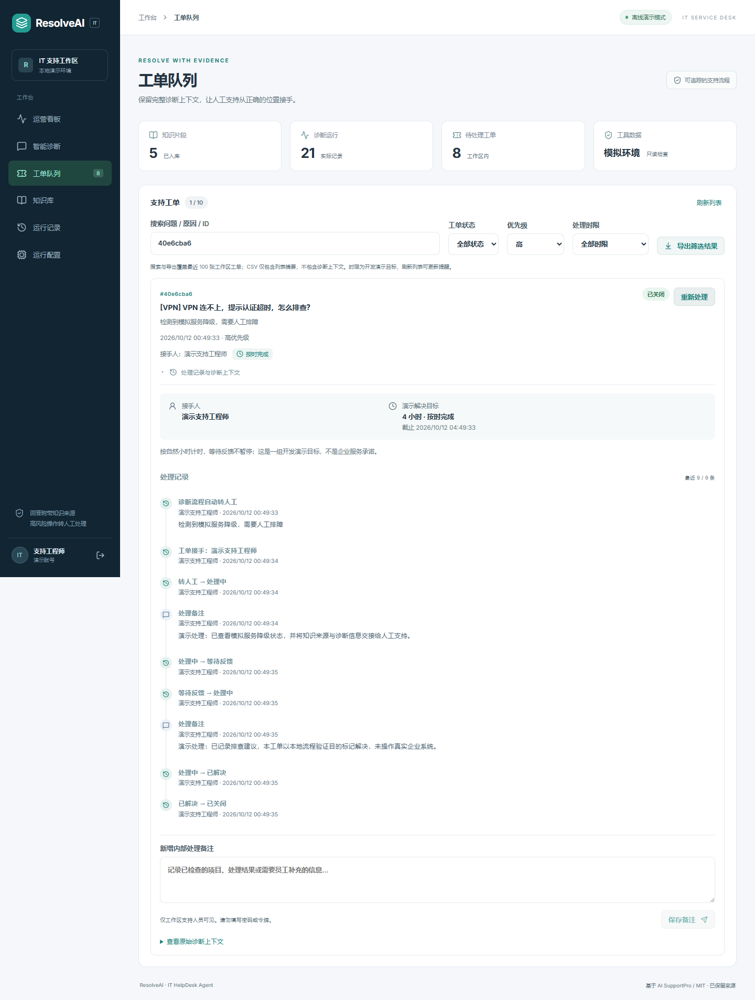
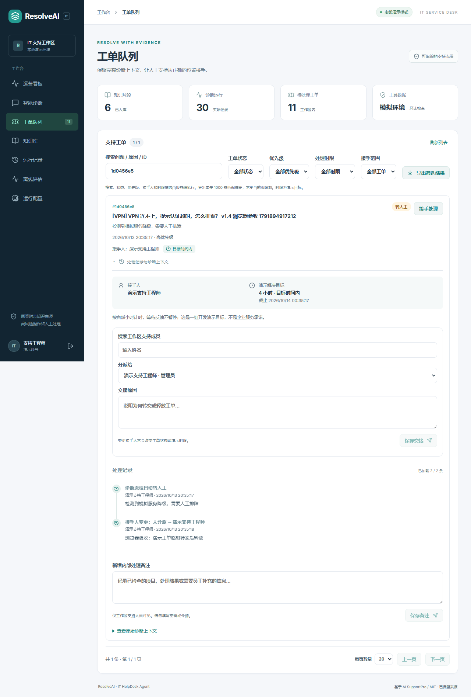
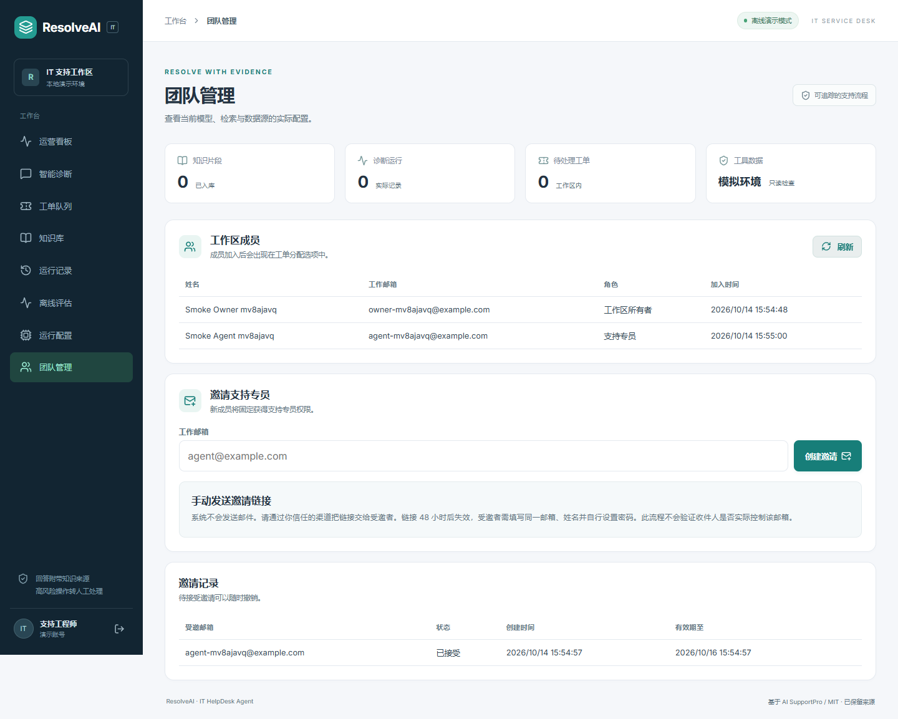
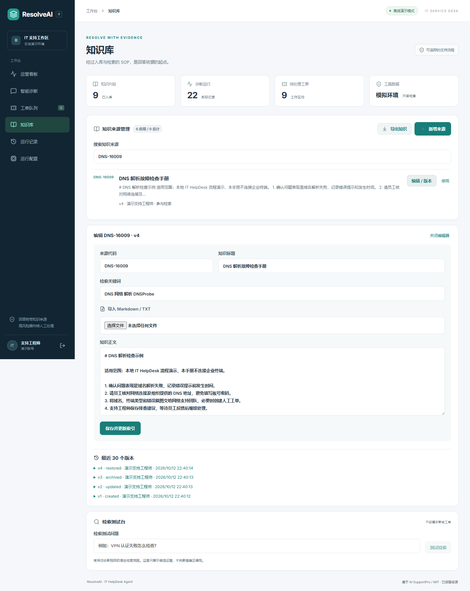
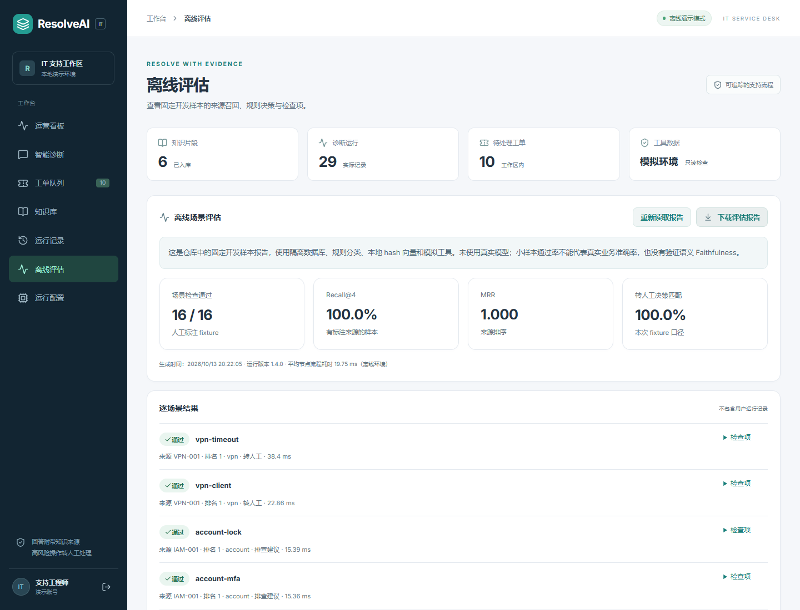

# ResolveAI 2.1 · 员工自助与 IT 支持协作

基于 [AI SupportPro](https://github.com/theclevertrader/ai-supportpro) 的 IT 支持场景改造，保留原始 MIT 许可证和版权。来源提交与改动范围见 [NOTICE.md](NOTICE.md) 和 [UPSTREAM.json](UPSTREAM.json)，原项目说明见 [README.upstream.md](README.upstream.md)。这是可运行的本地开发 MVP，覆盖证据诊断、人工交接与运营观测。

[](https://github.com/Marvin725626/resolveai-it-helpdesk/actions/workflows/ci.yml)

**FastAPI · LangGraph · React · 混合 RAG · IT HelpDesk**

[2.0 员工门户与服务目录](docs/V2_EMPLOYEE_PORTAL.md) · [v1.10 工单查找](docs/FINDING_TICKETS.md) · [v1.9 主动报障](docs/MANUAL_REQUESTS.md) · [v1.8 部署与恢复](docs/DEPLOYMENT.md) · [v1.7 功能说明](docs/TRIAGE_AND_TEAM_METRICS.md) · [工单处理流程](docs/TICKET_WORKFLOW.md) · [三分钟演示](docs/DEMO.md) · [截图与功能说明](docs/SHOWCASE.md) · [架构](docs/ARCHITECTURE.resolveai.md) · [验证记录](docs/VALIDATION.md) · [更新记录](CHANGELOG.md)

### 运营看板实机截图



截图来自本地离线演示的实际运行。指标是演示账号的诊断记录，不代表生产业务效果或真实模型响应耗时。

### 工作流程



## 公开数据实验：选择性意图分诊

新增独立 BANKING77 英文金融客服原型：词/字符双视角融合、开发集校准的低置信度转人工与消融评估。**不代表当前中文 IT 系统的线上提升，也不宣称算法首创。**

| 方案 | 官方测试准确率 | Macro-F1 | 合成错字准确率 |
| --- | ---: | ---: | ---: |
| 词特征基线 | 88.34% | 88.36% | 78.05% |
| 字符特征消融 | 89.90% | 89.87% | 83.34% |
| 双视角融合 | **90.81%** | **90.82%** | **83.70%** |

同一拟合/开发划分、3,080 条官方测试问题；融合相对词基线 +2.47 个百分点，配对 bootstrap 95% 区间 [+1.85,+3.18]。融合的本地 P95 推理延迟高于词基线；完整报告同时披露代价、19 条退步、7 个文本交集和工程修复重跑记录。

[实验方法、复现命令与限制](benchmarks/banking77/README.md) · [原始指标JSON](benchmarks/banking77/results/report.json) · [逐类消融](benchmarks/banking77/results/per_class.csv)

## 2.1：服务目录维护

管理员可以直接编辑和发布服务，阅读历史表单与当前版本的差异，将历史内容载入编辑器另存新版本，也能复制现有服务为独立草稿。切换与刷新会提示未保存的编辑；旧申请快照保持原样。参见[目录维护说明](docs/CATALOG_MAINTENANCE.md)。

## 2.0：从员工申请到支持处理

- 员工门户：专属员工身份，查看本人请求和通知，按服务表单提交申请。
- 服务目录：管理员配置字段、发布或归档服务，版本冲突保护和修订记录。
- 申请快照：工单保留提交时的表单版本与答案，后续编辑不改写旧申请。
- 处理闭环：复用工程师分派、公开沟通、私有附件、解决记录及员工确认评分。



## 工单查找与来源分流

- 我的报障支持关键词、状态、来源组合筛选，按匹配结果分页。
- 支持队列区分主动报障、AI 转人工与历史工单，CSV 和保存视图使用相同来源条件。
- 个人搜索限定本人提交内容，保留旧保存视图和请求重试兼容。

## 主动报障

- 在“我的报障”直接提交问题，展示实际来源、问题分类和提交内容。
- 与既有工程师接手、公开回复、私有附件、确认解决及评分流程衔接。
- 请求重试不重复建单，报障所有权按登录用户和工作区隔离，AI 诊断统计保持独立。

## 部署与恢复

- 独立 Docker 一键启动：PostgreSQL、API 与同源前端，默认 5184/8114，数据库和附件使用持久卷。
- 数据与附件恢复：SQLite 离线 bundle 校验并恢复到新目录；PostgreSQL 合成数据 dump/restore 演练。
- 可重复交付检查：数据库迁移、真实向量检索、业务闭环及容器重建持久化，结果见[验证记录](docs/VALIDATION.md)。

## 日常分诊与团队运营

- 优先级调整：预览新时限、填写原因，工单版本和请求ID保护，处理记录可追溯。
- 个人保存视图：搜索、状态、优先级、接手范围及时限条件持久保存，直接应用常用工作队列。
- 团队运营：当前积压、未分派、即将逾期、逾期及接手人工作量；解决轮次、去重工单与满意度分别统计并支持JSON导出。

[分诊与团队运营说明](docs/TRIAGE_AND_TEAM_METRICS.md)。当前快照与历史时间窗口分开，数值来自实际工作区记录，不代表生产业务效果。

## 解决工单到知识积累

- **解决记录**：工程师填写解决分类、公开摘要与步骤，按解决轮次保存，重新处理后保留历史。
- **本人验收**：报障人确认关闭后可给本轮 1–5 分满意度与留言，与 AI 回答反馈分开。
- **知识审核**：从公开解决记录人工整理草稿，管理员编辑、驳回或发布；发布后更新真实知识版本和检索索引。
- **完整协作**：个人通知、本人公开跟进、截图与日志私有附件一起纳入本批代码。

[解决、验收与知识审核说明](docs/RESOLUTION_LOOP.md) · [本人跟进](docs/REQUESTER_FOLLOWUP.md) · [私有附件](docs/PRIVATE_ATTACHMENTS.md)



截图来自随机测试账号和模拟工单；发布记录与检索结果为本地实际执行，不代表生产客户数据。

## 已实现

- 中文 React 工作台：问题诊断、引用原文、实时节点轨迹、工具返回值、人工工单、知识入库和运行记录。
- FastAPI + LangGraph：分类 → 混合检索 → 证据检查 → 工具调用 → 回答 / 人工工单。证据不足最多检索两次。
- 检索：SQLite 下 BM25 + 本地 hash 向量；PostgreSQL 下全文检索 + 真正的 pgvector 向量查询；RRF 融合与词项覆盖重排。
- 工具：当前用户账号状态、服务健康、当前用户历史工单。前两项明确为本地模拟数据；工具身份由 JWT 固定，不接收任意员工身份。
- 工单附带问题、SOP 证据、工具输出和诊断；支持接手、解决、关闭与重新处理。
- 请求 ID 防重复工单、租户 / 用户隔离、凭据文本脱敏、图执行上限和模型超时。
- 工作台时间按 Asia/Hong_Kong 显示；API 输出明确的 UTC 时间戳。
- 运营看板：最近 7 / 30 / 90 天诊断趋势、转人工率、证据通过率、平均 / P95 耗时、问题分类与工单状态分布；支持指标 JSON 导出。
- 工单接手到当前工程师、内部处理备注、自动保存的状态时间线，以及等待反馈 / 继续处理 / 解决 / 关闭 / 重新处理。
- 管理员按实际工作区成员分派、转交和释放工单，必填交接原因、版本冲突保护和请求防重复；处理时间线可继续加载更早记录。
- [工单私有附件](docs/PRIVATE_ATTACHMENTS.md)：报障人与支持团队可上传、下载和删除截图 / UTF-8 日志；按工单权限鉴权，单份5MiB、每工单20份，附件不送模型。
- [我的报障跟进](docs/REQUESTER_FOLLOWUP.md)：现有工作区成员查看本人 AI 转人工工单，与支持人员公开沟通、补充资料、确认关闭或说明后重新处理；公开回复与内部备注分开。
- [个人通知中心](docs/NOTIFICATIONS.md)保存分派给我、我的工单被转交或释放、他人更改负责工单状态的提醒，支持未读筛选、持久已读和准确打开关联工单。
- 工作区管理员可创建 48 小时有效的一次性成员邀请；邀请令牌只显示一次、数据库只存 SHA-256 摘要，支持撤销与使用状态追踪。
- 受邀成员通过片段 URL 进入独立接受页，确认邀请邮箱并设置账号；新账号固定为支持专员，可登录并加入工单分派列表。
- 管理入口按当前账号角色显示，邀请管理与成员列表均服务端校验租户及所有者 / 管理员权限。
- 按优先级计算的演示解决时限：即将超时、超时与按时完成提醒；自然小时计时，不暂停、不重置。
- 工单搜索、状态 / 优先级 / 时限筛选与 CSV 导出；CSV 包含接手人和目标截止时间，处理中文、引号与公式前缀。
- 诊断“有帮助 / 仍需帮助”反馈持久化，允许修改选择，看板统计实际反馈数量。
- 当前接手人权限、状态机、带时间版本的更新冲突检测、备注请求防重复、备注脱敏；旧版接口不能绕过 ResolveAI 工单处理流程。
- 工单服务端分页、关键词 / 状态 / 优先级 / 接手范围 / 活跃时限筛选；跨页导出最多 1000 条匹配摘要。
- 当前账号运行历史分页，按问题、状态、分类与滚动时间筛选；完整轨迹及证据按需读取。
- 离线评估页面和 JSON 下载：16 个固定开发样本，使用独立临时数据库，CI 自动执行同一检查。
- 运行检查：实际数据库查询、当前知识索引身份匹配、密钥配置状态（不返回密钥）。
- SQLite 在线备份、完整性检查、拒绝覆盖原库与越界写入；备份仅保存到私有 `.local`。
- 后端隔离回归及通知 / 本人跟进 / 附件 / 解决评分 / 知识审核定向检查，CSV 格式验证、前端类型与格式检查、真实浏览器流程。各业务套件独立进程运行。

邀请链接由管理员通过可信渠道手动发送；项目没有配置邮件发送服务，也不验证收件人实际控制该邮箱。请把它视为开发演示的 bearer 邀请凭证，不是企业身份验证或生产级邮件邀请系统。

### 实际工单处理记录



操作者与时间由后端记录。备注描述的是本地演示操作，未连接真实企业系统；升级前的工单不会补造历史记录。

### 管理员交接（v1.4.0）



分派与释放均写入实际处理记录。浏览器验证包括后端已提交但响应被丢弃，再用原请求重试且没有重复事件。更多规则见 [工单协作说明](docs/TICKET_WORKFLOW.md)。

### 工作区成员邀请（v1.5.0）



工作区所有者和管理员可以生成一次性支持专员邀请链接、复制并手动发送，检查成员 / 邀请状态以及撤销未使用的邀请。新成员接受后以自己的账号进入当前工作区，自动出现在分派选项中。令牌保存在 URL 片段中，并在邀请页读取后立即从地址栏移除。

系统不会发送邮件或验证邮箱归属；链接持有者可以尝试接受邀请，因此管理员应只通过可信渠道分享，并把该流程作为本地演示功能使用。实现与限制见 [团队邀请说明](docs/TEAM_INVITATIONS.md)。

### 知识维护与运行恢复



- 知识按来源管理：编辑、自动重建索引、停用 / 启用、最近 30 个版本，以及恢复历史内容为新版本。
- 导入 UTF-8 Markdown / TXT（最大 64KB、正文最大 15000 字符），支持知识 JSON 导出。
- 检索测试台使用同一混合检索引擎，展示候选来源、覆盖率与 RRF，不创建诊断或工单。
- 编辑版本冲突返回 409；索引失败会回滚知识与索引；重启不会重新启用已停用的演示 SOP。
- 断线后读取原请求结果；同一标签页刷新可以找回未确认结果。超过三分钟仍在 running 的记录可以手动标记中断，再使用新请求诊断。

[知识管理与恢复说明](docs/KNOWLEDGE_AND_RECOVERY.md)包含 API、边界和实测步骤。

### 分页、评估与运维



[分页与评估口径](docs/PAGINATION_AND_EVALUATION.md) · [运维与备份](docs/OPERATIONS.md) · [功能状态与验证矩阵](docs/PROJECT_STATUS.md)

## 本机启动

项目路径：`E:\agent\resolveai`。已安装独立 `.venv` 和前端依赖，不需要启动第一个项目。

```powershell
cd E:\agent\resolveai
.\start.ps1
```

也可双击 `start_dev.bat`。脚本以隐藏后台进程运行服务，日志保存在 `.local/logs/`。

- 工作台：http://127.0.0.1:5174
- API 文档：http://127.0.0.1:8104/docs
- 本地演示账号由 backend/.env 中的 IT_DEMO_PASSWORD 配置；请自行设置，不要提交该文件。

停止本项目进程：

```powershell
.\stop.ps1
```

如端口被占用，可运行 `.\start.ps1 -ApiPort 8105 -WebPort 5175`，前端代理会对应调整。

## 其他机器安装

需要 Python 3.11+、Node.js 22+。锁定依赖来自本机已验证的安装版本。

```powershell
python -m venv .venv
.\.venv\Scripts\python.exe -m pip install -r backend\requirements.lock.txt
cd frontend
npm ci
cd ..
Copy-Item backend\.env.example.resolveai backend\.env
# 设置随机 AUTH_SECRET 和本地 IT_DEMO_PASSWORD 后启动。
.\start.ps1
```

启动时只在 development 且 `IT_DEMO_ENABLED=true` 时创建演示账号和五份 IT SOP。SQLite 文件为 `backend/resolveai.db`。账号、运行记录和工单均在独立数据库中。

## 接入真实模型

编辑 `backend/.env`：

```dotenv
DEFAULT_LLM_PROVIDER=openai
OPENAI_BASE_URL=https://your-provider.example/v1
OPENAI_API_KEY=your-key
OPENAI_MODEL=your-model
IT_EMBEDDING_PROVIDER=local
IT_EMBEDDING_DIMENSION=256
```

重启后端即可使用 OpenAI-compatible 模型进行函数调用选择与回答生成。模型必须支持 chat completions 的 tools；未配置密钥会让工具节点失败并转人工，不会伪装成成功。模型生成引用须来自检索到的来源，否则回退到 SOP 原文并转人工。真实模型不等于真实企业工具，账号和服务检查仍为模拟数据。

如使用真实 embedding，配置 `IT_EMBEDDING_PROVIDER=openai` 与 `OPENAI_EMBEDDING_MODEL`。更换维度需要新建开发数据库或编写迁移并重新索引；不要混用不同模型生成的向量。当前本机验证使用离线规则、SOP 摘录与本地 hash 向量，**没有进行真实 LLM 调用验证**。

## PostgreSQL / Docker

独立编排文件为 `compose.resolveai.yml`，使用 `pgvector/pgvector:pg16`，默认绑定 `127.0.0.1:5184`（Web）和 `127.0.0.1:8114`（API）。它有独立 Compose project、数据库卷和附件卷；原有 SQLite 演示服务 `5174/8104` 与其数据不受影响。部署入口、检查及恢复演练见[部署说明](docs/DEPLOYMENT.md)。

```powershell
cd E:\agent\resolveai
.\.venv\Scripts\python.exe scripts\docker_deploy.py up
.\.venv\Scripts\python.exe scripts\docker_deploy.py status
```

首次运行会生成仅本地保存的 `.local/docker/.env` 随机凭据；脚本不会打印或覆盖该文件。其它动作包括 `stop`、`postgres-check`、`live-check`、`recreate-check`。Docker/PostgreSQL 的本轮实际集成验证状态请看[验证记录](docs/VALIDATION.md)；该配置是本机演示与恢复验证，不是生产部署方案。

SQLite 数据库与私有附件可用离线 bundle 演练备份及恢复；它要求操作者先停止写入服务并明确传入 `--offline-confirmed`，恢复只写入全新的 `.local/restores` 目标，不覆盖现有数据。详细边界见[运维与备份](docs/OPERATIONS.md)。

## 验证

```powershell
cd backend
..\.venv\Scripts\python.exe -m pytest tests/test_resolveai.py -q
cd ..\frontend
npm run test:csv
npm run build
cd ..
.\.venv\Scripts\python.exe scripts\evaluate_isolated.py --strict
```

回归测试使用临时数据库，不修改演示数据库。新的评估脚本使用独立临时数据库，不修改演示库；结果写入 `docs/evaluation.offline.json`。它覆盖 16 个固定人工标注场景，检查分类、来源召回、转人工、引用格式、有界检索和脱敏。小样本不能支持真实业务准确率；引用格式检查不等于 Faithfulness 评估。旧 `scripts/evaluate.py` 保留为六场景的服务端演示脚本。具体限制见 [架构说明](docs/ARCHITECTURE.resolveai.md)。

## 展示与统计口径

看板诊断指标统计当前账号；工单状态统计当前工作区的全部工单。日期按香港时间划分，转人工率与证据通过率以完成诊断为分母，无样本时显示 `—`。证据通过率不是正确率；P95 使用最近秩法。

工单队列和运行记录使用服务端分页，默认每页 20 条、最多每页 100 条。工单导出覆盖筛选结果的最多 1000 条，仅包含摘要；超出时会明确提示截断。详细边界与演示步骤见 [DEMO.md](docs/DEMO.md)。GitHub 提供源码和截图；运行工作台需要启动本地服务。

## 示例

1. “VPN 连不上，提示认证超时，怎么排查？” → VPN SOP、模拟服务降级、自动人工工单。
2. “如何安装公司批准的办公软件？” → 软件 SOP 与来源引用。
3. “账号权限申请，请帮我转人工审批” → 带证据的人工工单。
4. “如何购买潜水艇发动机？” → 最多两次检索、证据不足转人工。

请依据实际代码、实测结果及本人完成的工作描述项目。当前代码不执行账号解锁、权限授予、生产服务重启，也没有真实企业部署数据。
