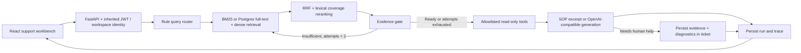

# ResolveAI architecture

## Boundaries

- `app/helpdesk/models.py`: isolated knowledge chunks and persistent run records, using inherited tenant/user IDs.
- `retrieval.py`: deterministic local hashing or remote embeddings; SQLite fallback for local demos; PostgreSQL pgvector cosine query and GIN full-text search, fused using RRF. Sparse ranking on SQLite is BM25. Reranking is lexical coverage, not a trained cross encoder.
- `workflow.py`: real LangGraph StateGraph with bounded retrieval retry, evidence gating, tool execution, grounded answer and ticket escalation. Query routing is rule based in both modes.
- `tools.py`: offline rules select tools in mock mode; OpenAI-compatible function calling selects tools in real model mode. The server validates the allowlist and fixes employee identity from JWT. Account and service states remain simulated in both modes. Historical tickets are real records from the isolated workspace, limited to the authenticated employee.
- `api.py`: durable request IDs prevent repeated tickets for a retried completed request, tenant/user isolation, SSE emits completed graph steps as they happen, and only commits ticket and final run together. The stream is graph progress, not artificial token-by-token output.

## Limitations

This is a local development MVP. It does not reset accounts, grant permissions, execute shell commands, restart services, connect to real enterprise identity systems, or claim production readiness. Evidence gating checks keyword overlap and citations; it is not a semantic faithfulness proof. Model answers can still be incorrect. Evaluation uses six tiny manually labelled fixtures, not a representative dataset.

The graph has no durable LangGraph checkpointer; durable final run records use SQLAlchemy. Process termination after reserving a run can leave its status at `running`; submit with a new request ID after fixing the failure. Database bootstrap uses inherited `create_all`; schema changes need planned migrations before shared deployment. PostgreSQL integration requires a live pgvector database and separate validation.
