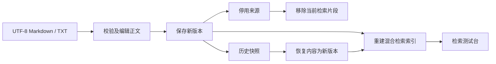
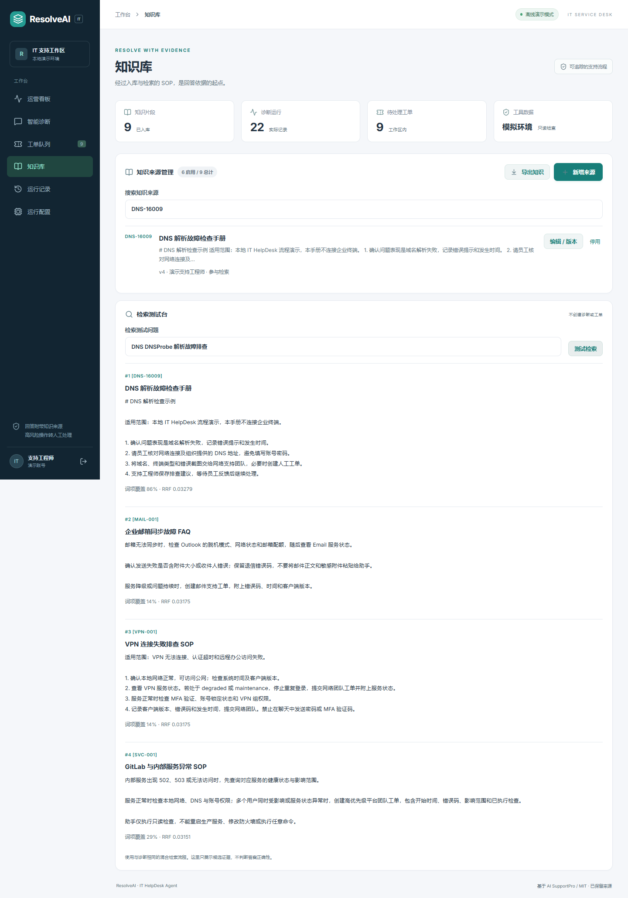
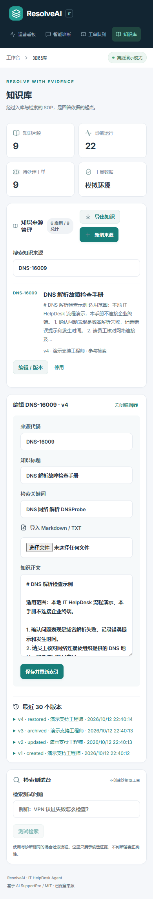

# 知识生命周期与运行恢复

## 知识流程



知识管理按来源代码组织完整文档，而不是逐个编辑检索片段。管理员可以创建、编辑、停用、启用和恢复；支持工程师可以查看与测试检索。编辑使用 expected_version，旧版本请求会被拒绝。每个来源 / 版本具有唯一约束，版本与索引在同一事务提交；索引失败会回滚旧内容和索引。

新建来源从 v1 开始。已有未版本化知识显示 v0；第一次编辑才保存旧内容快照，其时间和操作者是该次保存动作，不是虚构的原始作者或旧编辑时间。恢复历史内容会创建一个新版本，不会改写历史快照。

停用会移除当前检索片段，保留内容和版本。已完成诊断中的证据是当时保存的快照，仍可回看。启动种子不会重新启用管理员停用的来源。

## 文件与导出

仅支持 UTF-8 Markdown / TXT，单文件最多 64KB、正文最多 15000 字符。导入先填充编辑器，管理员保存后才入库。正文统一为 LF 换行；文件内容仅作为知识数据，未执行文件指令或代码。

JSON 导出包含当前工作区的来源正文、关键词、启用状态及当前版本元数据，不包含密码、令牌、用户认证记录或向量。它不是完整数据库备份，也没有实现自动恢复数据库或批量 JSON 回灌。

示例文件：[dns-check.md](samples/dns-check.md)。导出知识可能包含用户录入的内部资料，请按资料实际用途处理；项目发布不会上传导出的运行数据。

## 检索测试台



测试台调用与诊断相同的检索引擎，展示候选片段、词项覆盖与 RRF。不会保存新运行或创建工单，也不代表回答正确性。改变知识后清除旧预览，需重新测试。

## API

| 接口 | 用途 |
| --- | --- |
| GET `/helpdesk/knowledge` | 启用及停用来源列表 |
| POST `/helpdesk/knowledge` | 管理员创建来源 |
| PUT `/helpdesk/knowledge/{code}` | 按版本更新及停用 / 启用 |
| GET `/helpdesk/knowledge/{code}/revisions` | 最近 30 个版本 |
| POST `/helpdesk/knowledge/{code}/restore` | 按当前版本恢复历史内容 |
| POST `/helpdesk/knowledge/search` | 无运行副作用的检索测试 |
| GET `/helpdesk/knowledge/export` | 管理员导出当前知识 |
| GET `/helpdesk/runs/{id}` | 当前用户读取自己的运行 |
| POST `/helpdesk/runs/{id}/recover` | 标记三分钟以上的 running 记录中断 |

## 运行恢复

前端在 sessionStorage 中只保存待确认请求 UUID。断线后查询原运行结果，避免直接创建新请求；同一浏览器标签页刷新也会查询待确认结果。读取仍受 JWT 与当前用户 / 工作区范围限制。

运行记录页支持手动刷新、回看和填入问题重试。超过三分钟且仍为 running 的记录可以手动标记 interrupted；重试使用新 UUID，保留原记录。新鲜运行和已完成运行不能被标记中断。

这不是 LangGraph 节点级断点续跑，也不是后台任务强制终止机制。没有跨标签页恢复或浏览器关闭后的持久待确认状态。原结果未能查询时仍保留 ID供后续查询，不会自动反复执行诊断。

## 实测

27 项后端回归覆盖知识版本冲突、停用和恢复、历史证据快照、索引失败回滚、权限隔离、检索无运行副作用、导出和超时恢复。

浏览器脚本 `scripts/smoke-knowledge.cjs` 实际导入文本、编辑、停用、恢复、下载 JSON，然后在服务端完成真实诊断后人为中断响应，验证找回原结果且没有重复工单，再验证刷新恢复。它会创建开发演示知识、运行和工单。

```powershell
$env:RESOLVEAI_URL = 'http://127.0.0.1:5174'
node scripts/smoke-knowledge.cjs
```

Playwright 安装步骤见 [DEMO.md](DEMO.md)。



## 边界

新增表 resolveai_knowledge_revisions 由本地启动建表。共享部署仍需版本化数据库迁移。当前来源及历史版本在 Python 中按租户组织，适用于已声明的小规模本地演示；没有大规模知识分页、全文文件解析、OCR、企业内容审批或语义正确率验证。
