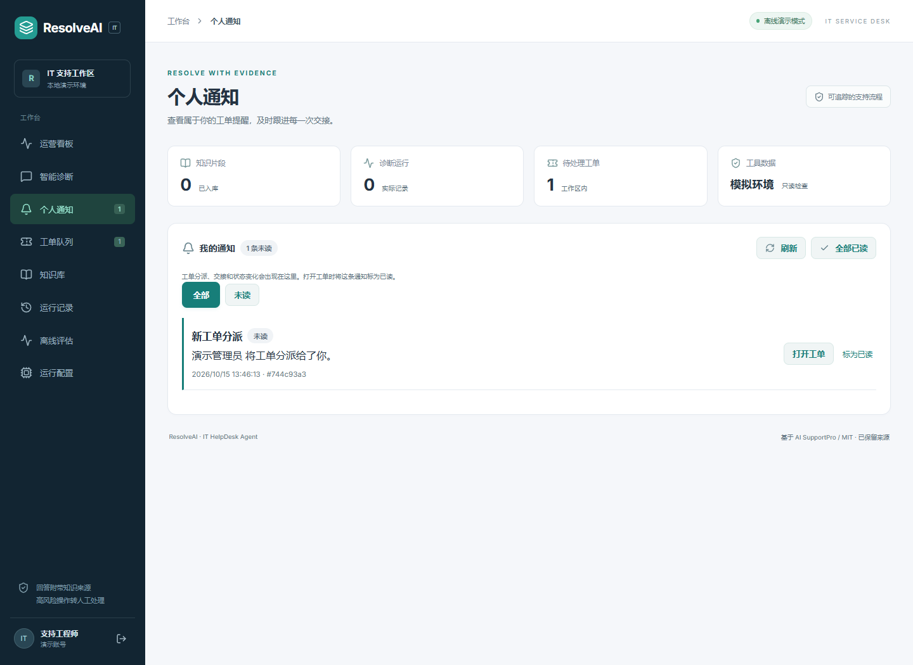

# 个人通知中心

这是本地工作台的站内提醒功能，不代表生产业务收益或通知送达承诺。

管理员把工单分派给另一名启用的工作区支持成员时，对方收到“新工单分派”；转交或释放时，原接手人收到“工单交接更新”；他人修改已分派工单状态时，当前接手人收到“工单状态更新”。自己操作不会提醒自己，未变化的状态与已缓存交接请求不会新增提醒。停用成员不接收新提醒。

通知中心支持全部 / 未读、手动刷新、单条 / 全部已读及加载更早通知。打开工单会先持久标为已读，再直达准确工单并展开处理记录，即使目标不在当前队列页中，也能继续接手、处理和解决。顶栏导航的未读角标在登录、切页时更新；可见页面每30秒读取一次轻量计数，隐藏页面暂停，恢复可见时刷新。

通知仅保存固定描述、操作者姓名及状态，不复制工单正文、交接原因或内部备注。通知与原事件在同一数据库事务提交；每个事件、接收者组合唯一。登录身份、operator角色、工作区与接收者共同约束访问，其他用户或工作区不能读取或标记你的通知。

API：

- `GET /api/v1/helpdesk/notifications?unread_only=false&page_size=20&before=<sequence>`：最新优先，最多50条，返回`items`、`unread_count`、`has_more`和`next_before`。
- `POST /api/v1/helpdesk/notifications/{uuid}/read`：幂等单条已读。
- `POST /api/v1/helpdesk/notifications/read-all`：仅当前用户的全部通知已读。

已有部署执行`cd backend`后运行`../.venv/Scripts/python.exe -m alembic upgrade head`；开发启动的`init_db`也会创建新表。没有历史补发、邮件、推送、WebSocket或后台投递任务。

本次验证使用隔离SQLite数据库和独立端口，两名随机密码账号完成管理员分派、接收者查看通知、打开关联工单、已读及状态操作；390px无横向溢出，浏览器无页面错误。定向后端测试开启SQLite外键，覆盖重试、转交、释放、状态规则、自操作排除、持久已读、用户 / 租户隔离及分页。迁移验证覆盖全新数据库和已有v1.5结构。没有验证PostgreSQL实机部署。

