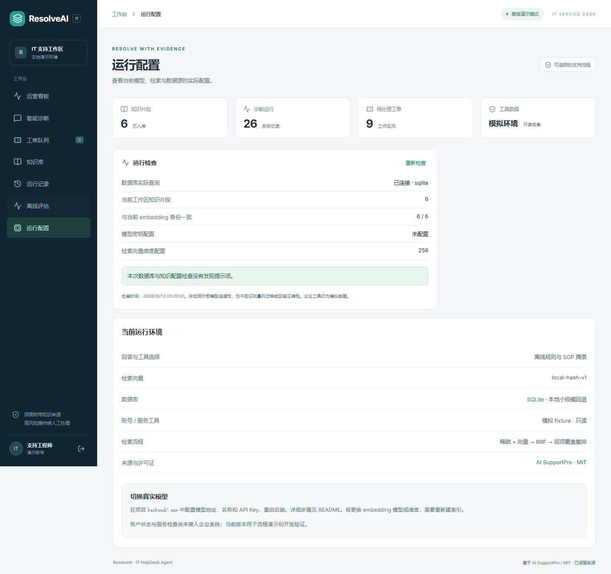

# 本地运维与数据备份

## 生命周期

启动 `.\start.ps1`，停止 `.\stop.ps1`。后台进程保持隐藏，日志位于 `.local/logs/`，进程记录包含 PID、端口；停止前校验命令行是否属于本项目。

工作台 http://127.0.0.1:5174，API http://127.0.0.1:8104/docs。本地使用独立 SQLite 库 `backend/resolveai.db`。主工作流、知识版本和处理事件均在同一项目数据范围内。

## 在线备份

```powershell
.\.venv\Scripts\python.exe scripts\backup_sqlite.py
```

使用 SQLite backup API 从只读连接生成一致快照，再运行 quick_check。默认保存到 `.local/backups/`，输出文件大小与 SHA-256；文件名包含 UTC 时间。脚本拒绝覆盖已有快照、覆盖原库或离开项目范围；CLI 输出还必须留在私有 `.local` 中。

备份包含用户、工单、运行和内部处理记录，可能含认证哈希与内部资料。它被 `.gitignore` 排除，项目发布不上传备份。此脚本仅适用于本地 SQLite，不负责 PostgreSQL 备份或自动恢复现有库。

恢复前应停止本项目服务，保留当前库的独立快照，再由明确的维护操作替换对应开发库。项目没有执行任何自动覆盖现有数据库的恢复操作。

## 运行检查



`GET /helpdesk/readiness` 验证数据库查询可执行，统计当前工作区知识片段和 embedding 身份匹配数，检查所选模式是否缺少密钥。只返回密钥是否存在，不返回密钥、地址中的凭据或完整环境变量。

这些检查不连接外部模型、不验证向量列迁移、不证明答案正确性；企业账号与服务工具仍使用明确标注的 fixture。

## 查询与结构

工单与运行的作用域 / 时间复合索引在本地启动时以 checkfirst 创建，包括已存在的表。分页读取摘要，详情按需读取。知识版本与工单事件新增表通过本地 bootstrap 初始化；共享部署仍需要版本化迁移。

## 常见处理

- 端口被占用：先用 stop.ps1 停止本项目，或指定新的 ApiPort / WebPort。
- 问题已提交但连接中断：保留同一标签页并查看运行记录；前端会查询原请求结果，不会自动重复提交。
- 长时间 running：刷新运行记录，超过三分钟后可标记中断，再使用新请求诊断。
- 模型 / embedding 身份改变：确认维度与库结构，再重新索引；不要混用不同身份的向量。
- 知识保存失败：查看提示和日志；事务回滚保留原知识及索引。

## 构建依赖维护

本次发现并处理了实际 npm 审计问题：Vite 从 7.3.2 更新到 7.3.7，移除不需要的 singlefile 插件及 braces/micromatch 链，更新可兼容修复依赖。当前 npm audit 为 0 个已知报告项；这不代表完整安全审计。标准生产构建现在输出 index.html 与 assets/，开发工作台和 Docker 静态目录使用方式保持适配。

相关来源：[Vite Windows 路径问题](https://github.com/advisories/GHSA-fx2h-pf6j-xcff)、[braces 深度模式问题](https://github.com/advisories/GHSA-vfj7-8cjw-p6xm)。

CI 包含格式检查、CSV 检查、类型检查、生产构建和高等级 npm 审计检查。
