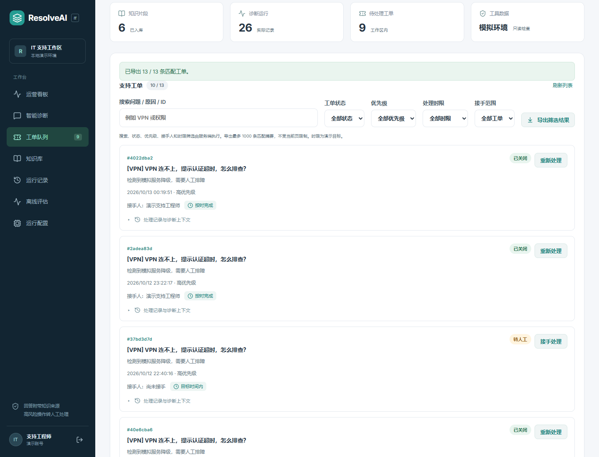
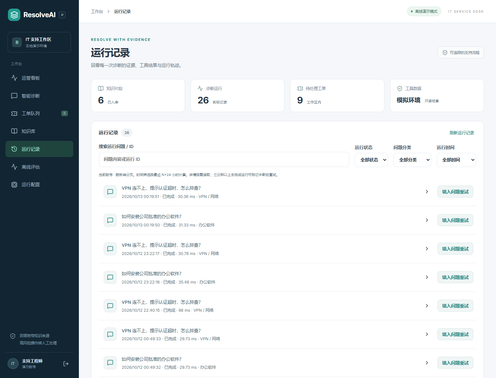
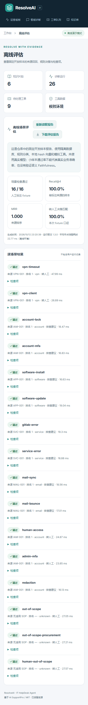

# 分页、导出与可复现评估

## 工单队列



`GET /helpdesk/ticket-queue` 使用当前工作区范围，在数据库中执行关键词、状态、优先级、接手范围和活跃时限筛选，然后统计总数与分页。排序为创建时间降序、ID 降序，静态数据下相同时间的记录仍有稳定顺序。

- `page`：1–100000；`page_size`：1–100，界面预设 10 / 20 / 50。
- `q`：最多 200 字符，匹配问题、升级原因或 ID；百分号和下划线按字面搜索。
- `assignment`：all / mine / unassigned。mine 的身份由 JWT 固定。
- `status`、`priority`：有效枚举；`sla` 为 on_track / due_soon / overdue，只筛选未完成工单。

时限筛选和行中徽标使用同一次查询的时间值。已完成记录仍显示原解决目标达成状态，但不参与活跃时限筛选。分页是实时列表，不是冻结快照；并发新增或状态变更可能改变相邻页结果。

`GET /helpdesk/ticket-queue/export` 使用相同筛选，从所有匹配记录读取最多 1000 条。返回 total 与 truncated，界面下载 CSV 后显示实际导出数 / 匹配总数。摘要和导出查询不选择完整诊断上下文，详情打开时才获取。

兼容接口 `/helpdesk/tickets` 仍保留最近 100 条行为，新工作台使用分页接口。

## 运行记录



`GET /helpdesk/run-history` 只查询当前工作区中的当前用户。支持 q、status、category、days、page 和 page_size。days 可为 1–365，以最近 N×24 小时计算；它与运营看板的香港日历窗口有明确区别。

列表在 SQL 中提取状态、类别、耗时和是否转人工的 JSON 摘要，不读取完整 trace / answer。打开记录调用当前用户范围内的 `/helpdesk/runs/{id}` 获取完整结果。兼容 `/helpdesk/runs` 保留最近 30 条；新界面不受这个旧上限限制。

## 离线评估


```powershell
.\.venv\Scripts\python.exe scripts\evaluate_isolated.py --strict
```

16 个标注样本位于 `backend/data/eval_cases.json`，覆盖五类 SOP、人工请求、无适用知识、检索上限和密码文本脱敏。脚本启动独立临时 SQLite 数据库、固定 mock/local 配置，运行真实 LangGraph 工作流并在结束后清理数据库，不修改正在使用的演示库。

报告 `docs/evaluation.offline.json` 包含软件版本、UTC 生成时间、逐案例结果和检查项；页面读取这个固定报告，重新读取不会执行新评估。报告不包含工作区用户运行记录，下载同样只返回固定样本结果。

本机本次报告 16 / 16 场景检查通过，Recall@4 与 MRR 均为 1.0。来源指标仅使用有人工标注来源的样本，转人工及分类指标使用全部 16 例。这是规则路由、hash 向量和模拟工具的固定小样本回归，未调用真实模型，也未评估语义 Faithfulness 或生产业务提升。平均耗时仅为该次离线执行结果，不代表真实模型延迟。

CI 在独立数据库执行同一脚本，任何 fixture 检查失败会让构建失败。CI 的临时结果不会自动覆盖仓库中已提交的本机报告。

## 验证范围

- 34 项后端回归；其中使用 1005 条隔离合成工单检验分页、接手筛选、字面搜索、跨页导出与 1000 条上限。
- 55 条相同创建时间的隔离运行记录检验稳定排序，另有 60 天前记录检验滚动时间筛选；这些是测试数据，不是企业客户数据。
- 浏览器实际翻页、导出跨页结果、筛选接手范围和分类、按需打开完整结果、下载评估 JSON、测试 390px 布局。


