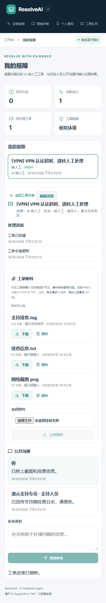

# 工单私有附件

现有工作区成员可为本人发起的AI转人工工单补充截图和日志；支持团队在同一工单读取附件并回传排查材料。本轮没有新增角色、公开文件分享、内联预览或文件模型处理。附件不会送入LLM / RAG，也不自动脱敏或执行杀毒扫描。界面显示“对本工单报障人与支持团队可见，请先移除敏感内容”。

## 权限与操作

- 本人入口每次通过保存的诊断运行及登录用户确认工单归属；支持侧读取要求工作区支持权限。跨工作区或错工单的附件ID返回404。
- 本人或当前支持接手人、工作区所有者 / 管理员可上传。上传者或所有者 / 管理员可删除；其他支持人员可读取但不能任意上传或删除。
- 已关闭工单不能新增附件，但已有附件可下载，上传者和管理员仍能删除以清理敏感材料。已经成功的同请求可重放；已删除附件返回410且不会复活。
- 上传或删除成功会刷新双方工单版本，公开回复可直接继续。上传时若本人工单正等待补充，会在同一事务恢复处理中，保持创建时间、接手人及演示时限，仅发送一次附件提醒。

## 格式与存储

支持`.png`、`.jpg`、`.jpeg`、UTF-8 `.txt`、`.log`。服务端检查文件名、扩展名、PNG块结构 / CRC、JPEG标记结构或UTF-8文本；拒绝路径式 / 控制字符文件名、伪装图片及不支持的扩展名。客户端MIME与Content-Length不作为文件格式或大小可信依据。这些检查不等于完整图片解码或恶意内容检测。

单文件最多5MiB，每张工单最多20份活跃附件。附件POST总multipart字节上限为5MiB+64KiB，在框架解析 / spool前计数；缺少Content-Length的请求也累计限制。实际文件再次按64KiB块读取与计数。工单CAS成功后计数限额，避免同时写入越限。

默认存储为仓库`.local/attachments/<tenantUUID>/<fileUUID>`，可用`IT_ATTACHMENT_ROOT`覆盖。磁盘名称完全由服务端生成，用户文件名仅作显示；存储key和路径不进入DTO。下载通过Bearer鉴权的fetch Blob完成，设置`Content-Disposition: attachment`、`X-Content-Type-Options: nosniff`、`Cache-Control: private, no-store`，没有静态挂载或公开链接。

上传先暂存与验证，再落盘和提交元数据、事件及通知；数据库失败会清理本次新文件。相同请求ID核对工单 / 上传者 / 文件名 / 摘要，重试不会重复文件、事件或通知。删除先提交tombstone使列表及下载不可用，再删除磁盘文件；磁盘忙时返回`cleanup_pending`，可用相同附件ID重试清理。

## API与维护

两组路由分别以`/api/v1/helpdesk/my-tickets/{ticket_id}`和`/api/v1/helpdesk/tickets/{ticket_id}`开头：

- `GET /attachments?before=<sequence>&page_size=20`：只返回活跃附件，游标分页最多50条。
- `POST /attachments`：multipart字段`request_id`、`expected_updated_at`、`file`。
- `GET /attachments/{id}/download`：登录鉴权后下载。
- `DELETE /attachments/{id}`：JSON字段`expected_updated_at`；tombstone后的清理重试幂等。

已有部署在backend目录执行`../.venv/Scripts/python.exe -m alembic upgrade head`。开发启动的`init_db`也会创建附件表。备份时需同时保留数据库及私有附件根目录；仅备份SQLite无法恢复文件。

手工孤儿清理同样从backend目录、使用该实例的数据库与`IT_ATTACHMENT_ROOT`配置运行：

```powershell
..\.venv\Scripts\python.exe ..\scripts\cleanup_attachments.py
# 审核dry-run结果后才执行：
..\.venv\Scripts\python.exe ..\scripts\cleanup_attachments.py --apply --grace-hours 24
```

脚本没有后台调度，默认dry-run、24小时宽限期、最多1000个对象，最短宽限期为1小时。仅检查根目录内UUID工作区目录中的UUID文件或`.tmp-UUID`暂存文件，跳过符号链接、其他名称、新文件及所有数据库引用（包括tombstone）。删除文件失败的tombstone对象需通过原删除API重试，不能被普通孤儿清理误删。脚本不按用户文件名查找或递归删除目录。

## 本地验证范围

隔离SQLite和独立存储的定向业务测试开启外键，覆盖双方PNG / TXT / LOG、下载字节与摘要、归属隔离、非接手及非上传者权限、伪装格式与5MiB / 总请求上限、20份限额、请求幂等 / 不同内容409 / 陈旧版本、等待补充单提醒、数据库失败无残留、tombstone / unlink故障重试及受限孤儿清理。附件表fresh与上版升级迁移通过。

双会话浏览器在8198 / 5298隔离服务实际上传、Bearer下载并比较SHA-256、公开回复及删除，390px无横溢出，0页面错误。下图为合成内容截图。未验证PostgreSQL实机、生产存储恢复或生产业务指标。


