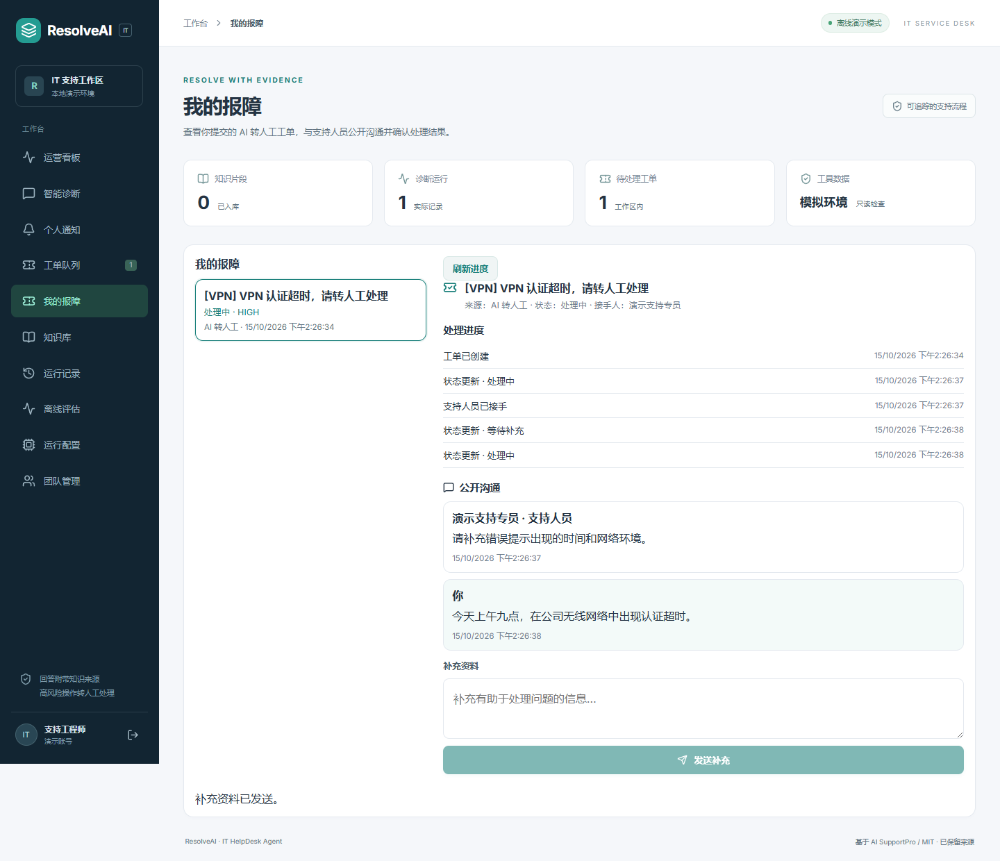

# AI 转人工后的报障跟进

“我的报障”面向现有工作区成员，展示其本人发起诊断后转人工的工单。这次没有新增独立员工角色、员工注册门户或匿名报障渠道。报障身份通过登录用户与保存的诊断运行关联，不能通过传入其他用户ID获得访问权。

成员可从工作台入口查看分页列表，也可从AI诊断结果直接打开准确工单。页面仅显示公开摘要、接手人、处理进度与沟通；不包含内部备注、交接原因、原始诊断上下文或工具数据。公开沟通与支持侧内部备注采用不同表和输入框，支持人员发送前可见“报障人可见”提示。

当前接手人或管理员可以公开回复。报障人补充资料时，若工单处于等待补充状态，会在同一事务恢复处理中；支持人员解决后，本人可以确认关闭，或填写公开说明将工单重新处理。重新处理清除解决时间，以后再次解决时记录新的解决时间。关闭工单拒绝新增公开回复，双方已有公开记录仍可读取；相同已成功请求仍可安全重放。

双方回复使用UUID请求ID防重复并校验工单更新时间。网络结果不明时保留原请求，409冲突后刷新并核对状态再重提。新回复、对应事件和提醒在同一事务写入；提醒只保存固定提示，不复制公开回复正文。公开回复列表支持before游标、page_size最多50条和加载更早回复，个人工单列表每页20条。

API：

- `GET /api/v1/helpdesk/my-tickets`及`GET /api/v1/helpdesk/my-tickets/{id}`：仅本人AI转人工工单。
- `GET/POST /api/v1/helpdesk/my-tickets/{id}/replies`：本人公开沟通。
- `GET/POST /api/v1/helpdesk/tickets/{id}/replies`：支持侧公开沟通，写入限当前接手人或管理员。
- `POST /api/v1/helpdesk/my-tickets/{id}/confirm-resolved`：本人确认解决关闭。
- `POST /api/v1/helpdesk/my-tickets/{id}/reopen`：本人附公开说明重新处理。

已有部署在backend目录执行`../.venv/Scripts/python.exe -m alembic upgrade head`添加回复表；开发启动也会创建新表。不补造历史回复。

本次验证在隔离SQLite与8197 / 5297端口执行双会话实机流程：AI转人工、工程师接手、公开追问、等待补充、本人刷新及补充、工程师解决、本人确认关闭。验证关闭后双方公开输入不可用、390px无横向溢出、浏览器0页面错误。定向后端测试覆盖归属隔离、公开字段、幂等与资源ID一致、CAS冲突、通知、关闭只读和重新处理；迁移覆盖全新与已有上版结构。没有验证PostgreSQL实机或生产业务收益。

