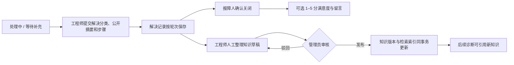
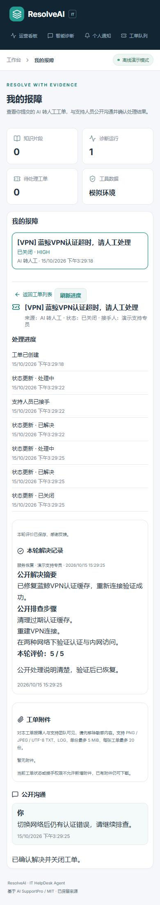

# 解决、验收与知识积累

本批把人工工单的后半段串起来：填写公开解决记录 → 本人确认关闭及可选评分 → 整理知识草稿 → 管理员审核 → 发布后进入真实检索。既有通知、公开回复与私有附件也一起保留。

## 工单解决与本人验收

支持人员在工单详情里选择解决分类、填写公开解决摘要及处理步骤后提交。当前接手人和工作区管理员可以操作；普通同事不能替别人的接手工单提交解决记录。原来的状态接口不能绕过解决摘要直接标记解决。

解决内容对本工单报障人与工作区支持团队可见；请先移除个人信息和敏感配置。公开摘要与内部备注分开，附件内容不会被自动读取或送给模型。

“我的报障”显示本轮解决内容。报障人可以确认关闭，或说明问题仍存在并重新处理。确认关闭后，评分为可选的 1–5 分及短评，每轮一次，与诊断页的“有帮助 / 仍需帮助”反馈分开。

重新处理不会覆盖上轮记录；再次解决会产生新的轮次和评分机会。历史已解决工单如果没有结构化摘要，会明确显示历史记录状态，不补造解决内容或评分。

主要接口：

- `GET /api/v1/helpdesk/tickets/{id}/resolution`
- `POST /api/v1/helpdesk/tickets/{id}/resolve`
- `GET /api/v1/helpdesk/my-tickets/{id}/resolution`
- `POST /api/v1/helpdesk/my-tickets/{id}/satisfaction`
- 原有 `confirm-resolved` / `reopen` 接口继续处理本人验收和重新处理。

解决操作使用请求 ID 与工单版本保护；重复原请求返回原记录，不会再次改变状态或重复通知。评分绑定明确的解决轮次，不能把旧轮次评价误记到新轮次。

## 知识草稿与审核

工程师在当前解决记录中选择“整理为知识草稿”，人工填写可复用的知识正文和关键词。初始内容只取公开解决记录，不自动复制原始诊断、内部备注或附件。

“知识库”中的草稿审核区可查看草稿：作者查看和修改自己的草稿，管理员查看本工作区草稿并编辑、驳回或发布。驳回须说明原因，修改后可重新提交审核。其他同事不能读取作者未发布的草稿。

草稿在发布前不参与检索。管理员发布时，知识版本、索引和发布状态在同一事务完成；索引失败会回滚，不留下“已发布但搜不到”的半成品。源工单已重新处理时，不能把上轮过时的解决经验直接发布。

发布后会显示实际知识来源代码和版本；可在既有检索测试台用相关词验证命中。后续更新沿用现有知识版本管理，已发布草稿保留发布记录。

主要接口：

- `GET /api/v1/helpdesk/knowledge-drafts`
- `POST /api/v1/helpdesk/knowledge-drafts`
- `GET /api/v1/helpdesk/knowledge-drafts/{id}`
- `PUT /api/v1/helpdesk/knowledge-drafts/{id}`
- `POST /api/v1/helpdesk/knowledge-drafts/{id}/reject`
- `POST /api/v1/helpdesk/knowledge-drafts/{id}/publish`

草稿编辑和审核使用版本冲突保护，发布重试复用已有来源，不重复创建知识版本。知识草稿不是自动生成的生产 SOP；管理员仍需确认内容正确、可公开且适用于本工作区。

## 本地运行与验证

从项目根目录运行 `.\start.ps1`，工作台默认 `http://127.0.0.1:5174`，API 文档为 `http://127.0.0.1:8104/docs`。沿用当前账号和数据库，新增表通过 Alembic 增量迁移建立。

定向验证包括解决轮次、本人评分、跨租户与同事权限、请求重试、版本冲突、草稿审核与真实检索、索引故障回滚；浏览器演示使用隔离数据库和临时随机账号，不把测试数据写入原工作区。

实际执行结果记录在 [验证记录](VALIDATION.md)。本批未验证真实 LLM、PostgreSQL 或生产部署。

## 实机展示

两张图均由隔离双会话脚本生成，只含演示人员名称和虚构VPN问题；未显示邮箱、密码、令牌或内部处理备注。
