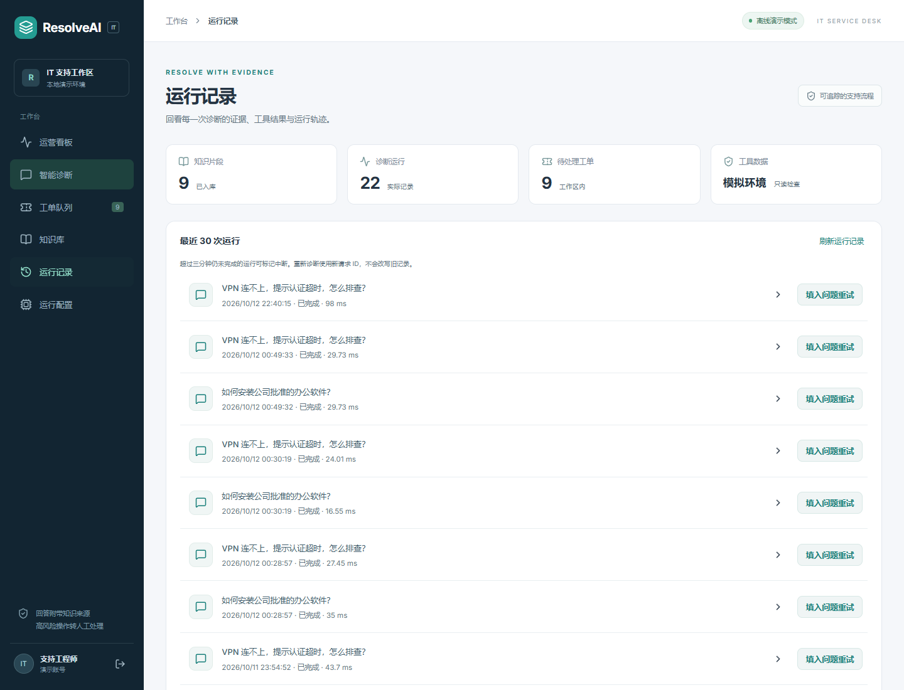

# ResolveAI 功能展示

以下图片由浏览器访问本地 FastAPI + React 服务生成。演示账号、模拟服务状态和离线 SOP 回答均为开发数据。

## 运营看板

从保存的运行数据统计每日诊断量、问题分类、转人工比例、证据门控通过比例与响应耗时。支持 7 / 30 / 90 天切换、刷新与 JSON 下载。图表附有可展开数据表。

诊断数据仅限当前账号。工单分布覆盖当前工作区全部时间，不随着诊断日期筛选改变。失败 / 运行中记录计入请求总量，不计入完成诊断比例的分母。零样本比例和耗时显示为空。

## 有证据的诊断与人工交接

VPN 问题从 SOP 检索到模拟服务降级结果，最终创建附完整诊断上下文的人工工单。工作台显示已完成的 LangGraph 节点、耗时、引用原文和工具实际输出。

## 工单筛选与导出

组合关键词、状态、优先级、接手范围与活跃时限进行数据库筛选和分页。CSV 下载全部匹配结果的最多 1000 条摘要，包括接手人、截止时间等字段；不导出完整上下文。中文 BOM、双引号转义与公式前缀处理经过独立校验。

## 真实处理时间线与协作

浏览器实际完成接手、两条内部备注、等待反馈、继续处理、解决和关闭。事件由后端记录，接手人来自 JWT，关闭保留解决时间。无效状态、抢占其他人的工单、过期页面覆盖和跨工作区操作会被拒绝。

同时支持“有帮助 / 仍需帮助”诊断反馈，保存后可回看，运营看板显示真实反馈数量。详细 API、状态机与时限策略见 [工单流程](TICKET_WORKFLOW.md)。

## 手机布局

已实测 390px 视口，无页面横向溢出。长时间窗口的每日图表在图表区域内横向滚动。

## 阅读代码

| 功能 | 关键代码 |
| --- | --- |
| 图工作流与人工交接 | `backend/app/helpdesk/workflow.py` |
| 混合检索与证据来源 | `backend/app/helpdesk/retrieval.py` |
| API 鉴权、窗口查询与工单范围 | `backend/app/helpdesk/api.py` |
| 指标分母、日期桶与 P95 | `backend/app/helpdesk/analytics.py` |
| 运营看板 | `frontend/src/AnalyticsPanel.tsx` |
| 接手、状态机、原子更新与时限 | `backend/app/helpdesk/ticket_ops.py` |
| 工单详情与处理时间线 | `frontend/src/TicketOps.tsx` |
| 工单工作台与筛选 | `frontend/src/ResolveApp.tsx` |
| CSV 格式与公式前缀 | `frontend/src/csv.ts` |

验证结果见 [VALIDATION.md](VALIDATION.md)，复现流程见 [DEMO.md](DEMO.md)。未验证真实 LLM、Docker 或 PostgreSQL 集成，不声称生产部署效果。

## 知识版本与运行恢复（v1.2.0）

新功能及真实验证边界见 [知识与恢复说明](KNOWLEDGE_AND_RECOVERY.md)。

## 分页、评估与运维（v1.3.0）

详见 [分页与评估](PAGINATION_AND_EVALUATION.md)、[运维备份](OPERATIONS.md) 和 [功能状态](PROJECT_STATUS.md)。
