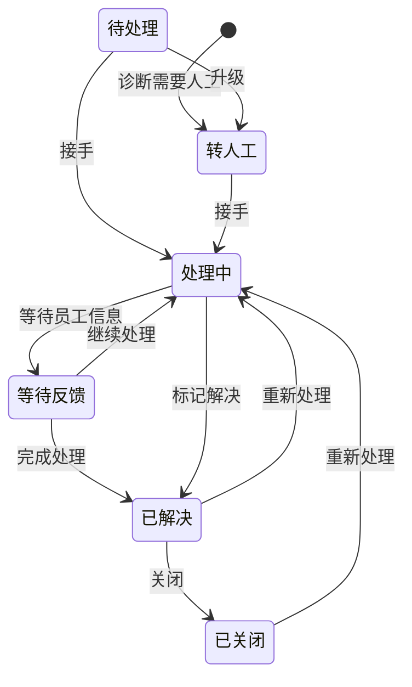
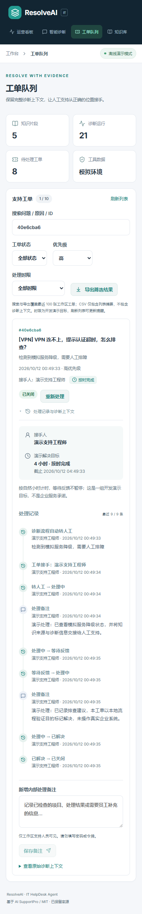

# 工单协作与反馈流程

这是一个可操作的本地 IT 支持流程：AI 保存诊断上下文，工程师接手、写备注、等待补充信息、标记解决并关闭。作者与时间来自数据库，操作不是预制前端动画。

## 状态机

非法转换返回 409。接手绑定当前 JWT 用户，客户端不能指定任意工程师 ID。支持工程师不能更改其他人已接手的工单状态；工作区管理员可以更改状态，但目前没有管理员强制转派界面。

## 操作与一致性

| 操作 | API | 保存内容 |
| --- | --- | --- |
| 获取详情 | `GET /helpdesk/tickets/{id}` | 当前状态、接手人、演示时限、最近 100 条事件 |
| 接手 | `POST /helpdesk/tickets/{id}/claim` | 当前操作者、接手及状态事件 |
| 更改状态 | `PATCH /helpdesk/tickets/{id}` | 前后状态、操作者、更新版本 |
| 内部备注 | `POST /helpdesk/tickets/{id}/notes` | 脱敏文本、作者、时间、备注请求 ID |
| 诊断反馈 | `POST /helpdesk/runs/{id}/feedback` | 当前用户对自己完成诊断的最新选择 |

接手及状态更新可以携带 `expected_updated_at`。服务端既检查客户端版本，也用 SQL 条件更新防止两个并发操作覆盖同一版本；冲突提示刷新后重试。状态修改和操作事件在一个事务提交。

事件使用数据库递增序号排序，即使多条操作具有同一个时间戳也保持顺序。备注请求携带 UUID，重复相同请求返回已有备注；相同 ID 的不同内容返回 409。详情折叠时不加载记录，打开后才查询，避免列表为每张工单额外加载时间线。

旧版 `/tickets/{id}` 写接口对 ResolveAI 工作流产生的工单返回 409，避免绕过这些规则。应用操作记录不是不可篡改的合规审计系统；数据库管理员仍能修改数据，也没有做防删存档、签名或独立审计服务。

## 演示解决时限

| 优先级 | 自创建开始的解决目标 |
| --- | --- |
| 紧急 URGENT | 1 小时 |
| 高 HIGH | 4 小时 |
| 普通 MEDIUM | 24 小时 |
| 低 LOW | 72 小时 |

这是开发演示策略，不是来自企业合同的 SLA。按自然小时计算，不扣除夜间、周末或等待反馈的时间。接手和重新处理不会重置原始目标。

未解决工单显示“目标时间内 / 即将超时 / 已超时”，接近阈值为 `min(1 小时, 目标的 25%)`。已经解决或关闭的工单按解决时间显示“按时完成 / 超时完成”，关闭不重写解决时间。历史已完成但无解决时间的工单显示“时间未知”。刷新队列可重新计算当前提醒；暂无后台定时通知。

## 诊断反馈

完成诊断后可选择“有帮助”或“仍需帮助”，也可以更改选择。相同选择重试不会改变反馈时间。反馈存入该运行记录，看板在当前账号、当前诊断日期窗口统计最新反馈；未反馈记录不计入反馈数。它不是企业满意度调查或业务提升证明。

## 手机详情

## 数据升级

新事件表为 `resolveai_ticket_events`；本地服务启动时通过现有 `create_all` 创建新增表，没有修改原有工单列。旧工单保留原记录，新操作开始积累时间线，不回填虚构历史。共享环境需要先备份并采用版本化迁移，不能直接把本地自动建表机制当成生产升级方案。
