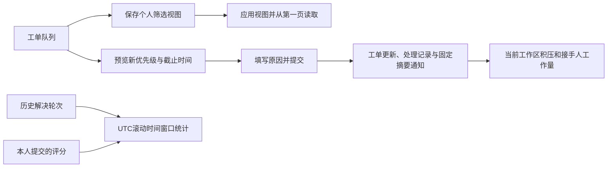

# 工单分诊、个人视图与团队运营

本批完善日常处理工单的三个环节：调整优先级、保存常用筛选、查看真实团队积压和解决情况。

## 可追溯的优先级调整

当前接手人及工作区管理员可以调整尚未完成工单的优先级。操作要求填写原因，并使用工单版本与请求ID保护，避免覆盖他人变更或因网络重试重复写记录。

提交前会显示新优先级对应的演示解决时限及目标截止时间。时限仍从原工单创建时间开始，按自然小时计算，不暂停、不重置：URGENT 1小时、HIGH 4小时、MEDIUM 24小时、LOW 72小时。提高优先级可能让旧工单立即逾期。

调整会保留创建时间和接手人，记录调整前后优先级与截止时间。已解决或已关闭工单不能直接改优先级，须先按原流程重新处理。通知只含固定摘要，不复制调整原因或工单正文。

## 个人保存视图

在工单队列把当前搜索词、状态、优先级、接手范围、时限条件和每页条数保存为命名视图，之后可以直接应用。视图保存到数据库，按工作区和当前账号隔离；每人最多保留10条。

只保存队列已有的合法筛选项，不保存工单正文、精确打开的工单ID、页码或任意URL参数。应用时回到第一页，并同步搜索框和实际搜索条件，避免防抖延迟造成旧查询结果。

视图支持版本保护和删除。删除后原创建请求重试不会让它复活；视图只是查询条件，不自动修改或分派工单。

## 团队运营口径

团队运营区位于运营看板，明确与当前账号的AI诊断指标分开。支持团队可以查看本工作区汇总，不能跨租户读取。

| 指标 | 统计范围 |
| --- | --- |
| 当前积压 | 全时间当前状态，包含等待补充，不含已解决和已关闭 |
| 未分派、即将逾期、逾期 | 当前未完成工单；时限与工单队列采用同一规则 |
| 接手人工作量 | 当前未完成工单的当前接手人；未分派单列，历史成员也不被丢弃 |
| 解决轮次 | 近7/30/90天，按结构化解决记录的resolved_at |
| 去重解决工单数 | 同一窗口内按ticket_id去重，和解决轮次数分别展示 |
| 满意度数量、均分与分布 | 同一滚动窗口，独立按评分created_at；没有评分时均分为空 |

时间筛选使用UTC滚动区间，页面时间按Asia/Hong_Kong显示。切换7/30/90天只改变解决与评分窗口，不改变当前积压快照。评分不是AI回答“有帮助”的反馈，也不计算缺乏可靠分母的“评价率”。

当前接手人工作量不代表历史个人绩效。项目没有保存每次解决时完整的历史优先级策略，因此本批不按当前优先级反推过去的时限达标率。

JSON导出只包含当前已读取的指标及其口径、时间范围，不包含工单正文、内部备注、评分留言、邮箱或附件。

## 验证与边界

针对验证使用临时数据库及合成工单，检查权限、请求重试、冲突、视图配额和持久化，以及时限边界、多轮解决、独立评分时间窗口和跨租户隔离。浏览器检查覆盖实际页面操作与手机宽度。

本批不增加自动分派、定时催办、外部邮件或生产监控。统计来自真实持久记录，但本地演示数据不是客户业务效果。实际执行结果见 [验证记录](VALIDATION.md)。

## API入口

- `GET /api/v1/helpdesk/tickets/{id}/priority`：当前优先级、调整权限和演示时限策略。
- `POST /api/v1/helpdesk/tickets/{id}/priority`：请求ID、预期工单版本、新优先级与原因。
- `GET /api/v1/helpdesk/queue-views` / `POST /api/v1/helpdesk/queue-views`：本人视图列表与创建。
- `PUT /api/v1/helpdesk/queue-views/{id}` / `DELETE /api/v1/helpdesk/queue-views/{id}`：按预期版本更新或删除。
- `GET /api/v1/helpdesk/team-metrics?days=7`：本工作区团队汇总，days仅接受7、30或90。

完整请求模型与返回字段以运行中的OpenAPI为准。

本地整合验证通过：优先级修改后立即更新队列时限；个人视图刷新、应用和删除生效；团队30天指标JSON实际下载核对正确；390px无横向溢出，浏览器无页面错误。浏览器复现入口为 `scripts/smoke-triage.cjs`，执行于独立临时数据库，不代表原工作区或生产数据。
